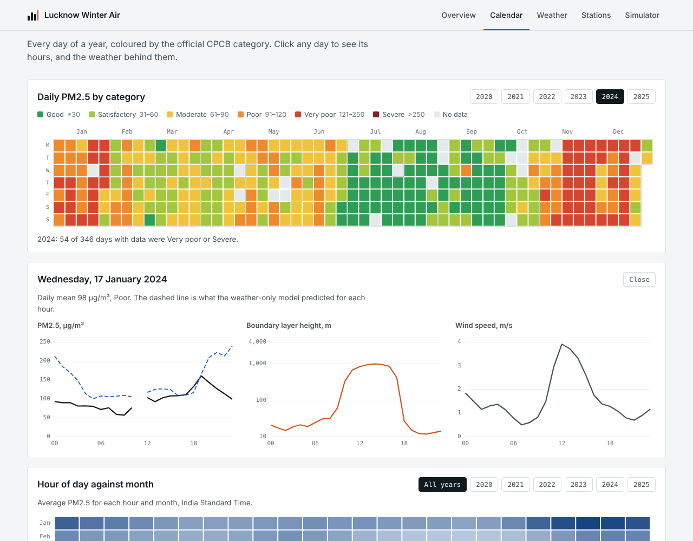
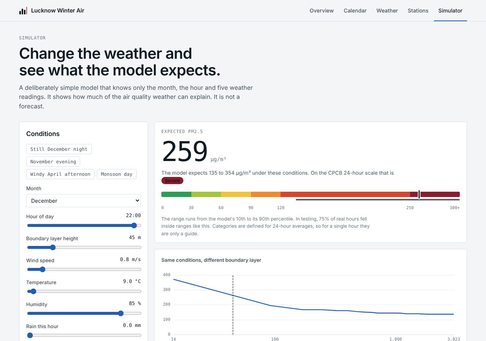

# Lucknow Winter Air

**How much of Lucknow's winter smog is the weather, and how much is us?**

I took six years of hourly PM2.5 readings from the Lalbagh monitoring station, took the weather out with a model, and built a dashboard to explore what was left.

**[Live dashboard](https://YOUR-RENDER-ADDRESS.onrender.com)** · Python, SQL, scikit-learn, FastAPI, ECharts

<!-- Write one or two sentences here in your own words: why you picked Lucknow and what you wanted to find out. -->



## What I found

- **Winters are not clearly getting cleaner.** After removing the weather, winter PM2.5 went 172, 105, 117, 108, 126 µg/m³ (2020-21 to 2024-25). A raw comparison would have shown a big improvement in 2021-22, but that was a well-ventilated winter.
- **Trapped air matters a lot.** On November to January hours when the layer of mixing air was under 27 m deep, PM2.5 averaged 191. Above 841 m it averaged 106.
- **The lockdown shows up, but its size is uncertain.** PM2.5 was about 37% below what the weather predicted. The same method is off by up to 22% in ordinary years.
- **Part of the data could not be trusted.** From 20 October 2025, Lalbagh's PM2.5 stopped following its own PM10, while a second station showed no such change. I excluded 1,677 hours. This is strong evidence of a sensor fault, not proof.

## What's in the project

| Part | What it does |
|---|---|
| `notebooks/` | Clean the raw CPCB files, cross-check two stations, compute the weather-adjusted numbers |
| `pipeline/build.py` | Loads the results into SQLite, trains the models with held-out blocks, writes the accuracy numbers |
| `app/main.py` | FastAPI. Every chart is one SQL query, except the simulator, which asks a model |
| `app/static/` | The dashboard: plain JavaScript and Apache ECharts, five views |

The dashboard has an overview, a calendar heatmap with a click-through to any single day, a weather page, a station comparison, and a simulator where you set the weather and see the expected PM2.5.



## Run it

```bash
pip install -r requirements-dev.txt
python -m uvicorn app.main:app --reload
```

Then open http://localhost:8000. Tests: `python -m pytest`.

The method, the model details and the API are in [docs/METHODS.md](docs/METHODS.md).

## Limits I want to be upfront about

- One station, so this describes Lalbagh's surroundings, not the whole city.
- Weather comes from ERA5, a roughly 28 km grid, not from sensors at the station.
- The data is refreshed by re-running the pipeline. CPCB has no free API, so this is not real-time.
- The model cannot tell why emissions changed. Its biggest input is a long-term trend that stands in for everything that is not weather.

## Data

- Pollution: Central Pollution Control Board, CCR portal. Lalbagh (site 277) and B R Ambedkar University (site 5460).
- Weather: Hersbach, H. et al. (2023). ERA5 hourly data on single levels. Copernicus Climate Change Service, DOI 10.24381/cds.adbb2d47.
- Charts: Apache ECharts 5.5.1 (Apache License 2.0).
